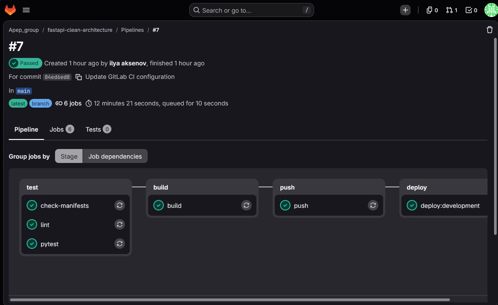
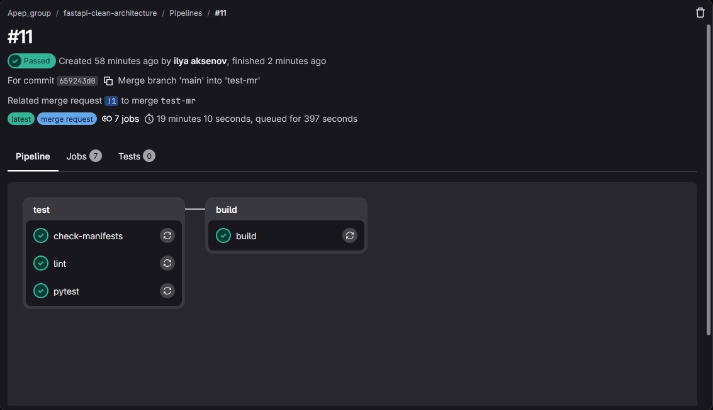
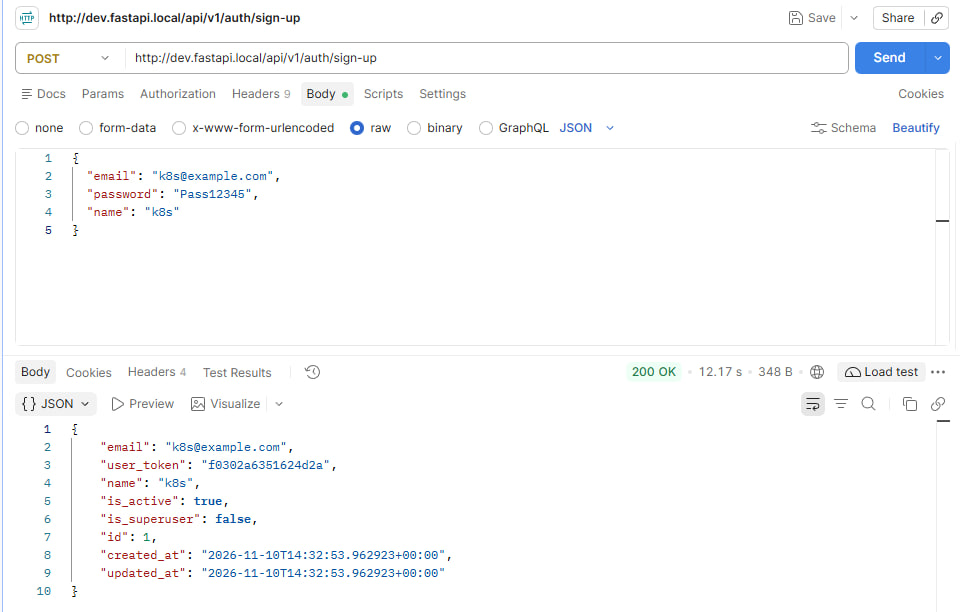
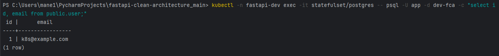

# Доставка FastAPI-сервиса в Kubernetes через GitLab CI

Тестовое задание: налаженный процесс доставки сервиса в Kubernetes-кластер.

Добавлены файлы инфраструктуры:

```
Dockerfile              образ приложения (
.dockerignore           что не попадает в образ
docker-compose.yml      локальный запуск: PostgreSQL + миграции + приложение
k8s/                    манифесты Kubernetes
  namespace.yaml          отдельное пространство окружения
  configmap.yaml          несекретные настройки
  secret.yaml             секреты для ручного запуска (в CI создаются из переменных GitLab)
  postgres.yaml           PostgreSQL (StatefulSet + Service)
  migrate-job.yaml        разовая задача с миграциями
  deployment.yaml         приложение
  service.yaml            внутренний доступ
  ingress.yaml            доступ снаружи кластера
.gitlab-ci.yml          пайплайн
```

## Что получилось

1. Разработчик открывает Merge Request, и запускаются проверки: линтер, проверка манифестов,
   тесты с настоящей PostgreSQL и пробная сборка образа.
2. После слияния в `main` образ публикуется в registry, и приложение автоматически
   обновляется в окружении Development.
3. Сервис доступен снаружи кластера по адресу `http://dev.fastapi.local`.
4. Данные запросов сохраняются в PostgreSQL, база лежит на постоянном диске.
5. Новые окружения (staging, production) добавляются без переделки пайплайна (см. ниже).

## Что выбрано

Всё работает локально, без облака:

| Компонент | Выбор |
|---|---|
| Кластер | Minikube |
| GitLab | GitLab CE в Docker, `http://localhost:8085` |
| Runner | GitLab Runner в Docker |
| Сборка образа | kaniko |
| Публикация образа | crane в локальный registry (`registry:2`) |
| Деплой | `kubectl apply` из job'а пайплайна |
| Доступ снаружи | Ingress (nginx), хост `dev.fastapi.local` |
| База данных | PostgreSQL 15 внутри кластера (StatefulSet с диском) |

## Как пользоваться пайплайном

| Этап | Что делает |
|---|---|
| test | `lint` (ruff), `check-manifests` (проверка YAML), `pytest` с PostgreSQL | 
| build | kaniko собирает образ в файл `image.tar` | 
| push | crane отправляет образ в registry (тег - короткий хеш коммита и `latest`) | 
| deploy | `deploy:development` обновляет приложение в кластере | 

Работа разработчика:

1. Создать ветку, внести изменения, отправить её в GitLab.
2. Открыть Merge Request в `main`. Запустятся проверки и пробная сборка. Образ при этом
   не публикуется и в кластер ничего не уходит.
3. Когда проверки зелёные, выполнить merge.
4. Пайплайн на `main` соберёт образ, опубликует его и обновит окружение Development.
   Статус виден в Deploy, затем Environments.
5. Если приложение не запустилось, деплой падает, а Deployment автоматически
   откатывается на предыдущую версию (`kubectl rollout undo`).

Порядок деплоя: namespace, настройки, секреты, PostgreSQL, миграции, приложение.
Приложение запускается только после успешных миграций.

### Настройка окружения для пайплайна

В GitLab, Settings, CI/CD, Variables (Environment scope `development`):

| Переменная | Тип | Назначение                          |
|---|---|-------------------------------------|
| `KUBECONFIG` | File | доступ к кластеру                   |
| `APP_DB_PASSWORD` | Masked | пароль PostgreSQL                   |
| `APP_SECRET_KEY` | Masked | `SECRET_KEY` приложения             |

### Добавление staging и production

1. Скопировать папку `k8s/` (например, в `k8s-staging/`) и поменять в ней namespace,
   значение `ENV` (`stage` или `prod`), `POSTGRES_DB` и хост в `ingress.yaml`.
2. Скопировать job `deploy:development`, поменять `K8S_DIR`, `NAMESPACE` и `environment`.
   Для production добавить `when: manual` и запуск по тегу.
3. Завести переменные `KUBECONFIG`, `APP_DB_PASSWORD`, `APP_SECRET_KEY` с Environment scope
   нового окружения. Общий шаблон деплоя `.deploy` и образ остаются теми же.

## Локальный запуск в Docker

```bash
cp .env.example .env
docker compose up --build -d
```

Порядок старта: PostgreSQL, затем миграции (`alembic upgrade head`), затем приложение.
Swagger: `http://localhost:8000/docs`.

## Особенности конфигурации приложения

Из `app/core/config.py`:

- Имя базы выбирается по `ENV`: `dev` - `dev-fca`, `stage` - `stage-fca`, `prod` - `fca`,
  `test` - `test-fca`. Любое другое значение `ENV` приложение не запустит. Контейнер PostgreSQL
  создаёт нужную базу сам через `POSTGRES_DB`.
- Порт БД по умолчанию `3306` (MySQL), поэтому для PostgreSQL `DB_PORT=5432` задаётся явно.
- Пароль подставляется в строку подключения без экранирования, поэтому в нём только буквы и цифры.

## Принятые решения и почему

- **Образ собирается без Docker-in-Docker** (kaniko и crane). Runner не нужен privileged-режим.
- **Миграции отдельной задачей (Job)**, а не при старте приложения. При нескольких репликах
  они не мешают друг другу, а ошибка видна в логе пайплайна.
- **Секреты не хранятся в git.** Они лежат в переменных GitLab и попадают в кластер при деплое.
- **Тег образа равен короткому хешу коммита.** По нему видно, какой код запущен.
- **`resource_group`** запрещает два одновременных деплоя в одно окружение.
- **Проверки готовности (readiness и liveness).** Трафик идёт только на готовое приложение,
  зависшее перезапускается.
- **Dockerfile в один этап** с закреплённой версией Python и запуском от непривилегированного пользователя.

## Ограничения решения

- Всё работает локально. GitLab CE, runner, registry и кластер недоступны снаружи вашей машины.
- Registry (`registry:2`) работает по HTTP и без авторизации, кластеру он разрешён как insecure.
  Для реального проекта нужен защищённый registry (GitLab Container Registry или облачный).
- PostgreSQL внутри кластера: один под, без репликации и бэкапов. Это подходит для Development,
  но не для production.
- Нет TLS, адрес `dev.fastapi.local` прописан в файле hosts, доступ идёт через `minikube tunnel`.
- Окружения различаются копиями папки `k8s/`, поэтому они могут разойтись между собой.
- Линтер включён в минимальном режиме (только реальные ошибки), чтобы не ломать существующий код.
- Пароль базы хранится на диске PostgreSQL. При смене секрета на существующем диске пароль
  внутри базы не меняется.

## Что бы я сделал иначе при большем времени и ресурсах

- Использовал Kustomize или Helm вместо копирования папок, и GitOps (Argo CD или Flux).
- Заменил доступ через `KUBECONFIG` в переменной на GitLab Agent for Kubernetes.
- Взял управляемый PostgreSQL или оператор (CloudNativePG): бэкапы, восстановление, реплики.
- Подключил TLS (cert-manager), менеджер секретов (Vault, external-secrets), NetworkPolicy,
  автомасштабирование и PodDisruptionBudget.
- Добавил сканирование образа и зависимостей, подпись образов, динамические окружения для
  каждого Merge Request, метрики и логи (Prometheus, Loki).
- Включил строгий линтинг и отчёт о покрытии тестами, а миграции делал совместимыми
  с откатом приложения.

## Вопросы к команде перед внедрением

1. Где будут жить окружения: облако или свои серверы, сколько кластеров? Какие есть GitLab,
   runner'ы и registry?
2. Какие требования к базе данных: объём, бэкапы, допустимые потери и время восстановления,
   нужна ли управляемая БД? Кто отвечает за миграции?
3. Как должны выходить релизы: автодеплой `main` в Development, а в staging и production
   по тегу или вручную, нужны ли согласования, canary или blue-green?
4. Как хранить и менять секреты, какие требования к безопасности?
5. Какие требования к доступности, нагрузке и масштабированию? Какие метрики, логи
   и оповещения обязательны?
6. Какая модель ветвления, какие правила ревью и обязательные проверки в Merge Request?


## Демонстрация

### 1. Пайплайн в GitLab работает

Merge Request запускает проверки, после слияния в `main` проходят все четыре этапа
(test, build, push, deploy), и код попадает в окружение Development.




### 2. Сервис отвечает на запросы

Сервис доступен снаружи кластера по адресу `dev.fastapi.local`.

<!-- СКРИНШОТ 2: Postman (метод POST, адрес http://dev.fastapi.local/api/v1/auth/sign-up,
     тело запроса и ответ 200 OK с id пользователя).
     Файл: docs/screenshots/02-service.png -->


### 3. Данные сохраняются в PostgreSQL

Запись созданного пользователя видна в базе внутри кластера:

```bash
kubectl -n fastapi-dev exec -it statefulset/postgres -- \
  psql -U app -d dev-fca -c "select id, email, name from public.user;"
```




# fastapi-clean-architecture

## description
Base FastAPI project for applying general RestAPI Application cases.


## concept
1. Minimal functionality.
2. Convincing architecture.
3. Easy to read.
4. Compatibility.
5. Versatility.

## base models
1. user
2. post [user (1 : n) post]
3. tag [post (n : n) tag]

## integrated with
1. Python3.9+
2. Fastapi 0.78.0
3. Database
   1. MySQL5.7+
   2. Migration with alembic
   3. pytest with real DB
   4. Load with two ways (eager, lazy)
   5. Modeling with schema (1:1, 1:n, n:n)
4. dependency-injector
   1. service-repository pattern
5. JWT authentication
   1. role separation each endpoint
6. Deployment
   1. container environment(k8s, docker)
   2. raw WAS(Web Application Server)

## commands
1. db(alembic)
   1. `alembic upgrade head`: apply every migrations
   2. `alembic downgrade base`: rollback every migrations
   3. `alembic revision --autogenerate -m "revision_name"`: create new migration 
   4. `alembic history`: get alembic revision history
2. How to migration
   1. Create or modify models from `app/model/*.py`
   2. `alembic -x ENV=[dev|stage|prod] revision --autogenerate -m "revision_name"`
   3. Check auto generated migration file from `app/migrations/versions/*.py`
   4. `alembic -x ENV=[dev|stage|prod] upgrade head`  
      If ENV does not exist, it will be applied to the test.
3. server
   1. `uvicorn app.main:app --reload`: base
   2. options
      1. host: `--host 0.0.0.0`
      2. port: `--port 8000`
4. test
   1. `pytest`: base 
   2. `pytest --cov=app --cov-report=term-missing`: coverage with stdout
   3. `pytest --cov=app --cov-report=html`: coverage with html

## sample env
```dotenv
# mysql case
ENV=dev
DB=mysql
DB_USER=root
DB_PASSWORD=qwer1234
DB_HOST=localhost
DB_PORT=3306

# postgres case
ENV=dev
DB=postgresql
DB_USER=gyu
DB_PASSWORD=
DB_HOST=localhost
DB_PORT=5432
```

## references
1. [FastAPI official docs](https://fastapi.tiangolo.com/)
2. [alembic official tutorial](https://alembic.sqlalchemy.org/en/latest/tutorial.html)
3. [Dependency Injector](https://python-dependency-injector.ets-labs.org/)
